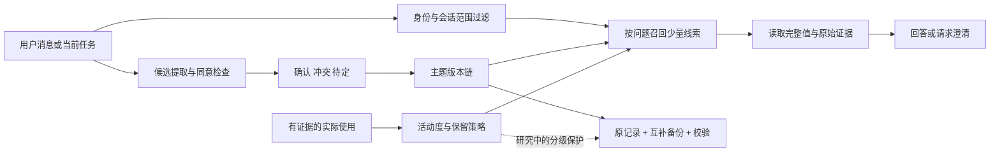

# MemoryGene：同类调研与吸收方案

研究日期：2026-10-28。以官方仓库文档与选定源码为依据；固定版本见 [来源清单](RESEARCH-SOURCES-2026-10-28.json)。这次没有安装竞争产品、接入其云服务或复现其性能榜单。下面的“吸收”是独立实现机制，不是拼接或复制第三方代码。

## 结论与产品定位

MemoryGene 应先成为一个**能找回、能核对、能修订、能真正忘掉的本地记忆 Skill**。在此基础上研究 DNA 启发的成对冗余、版本继承与分级保护。不要把“记忆越来越多”等同于“记忆越来越好”，也不要把 ATCG 表示当作语义检索算法。

最适合先吸收的是渐进读取；其次是分层生命周期、来源与时间语义；然后才是多路召回和宿主原生接入。保留当前 SQLite、零运行时第三方依赖、明确用户证据与确认门槛，不立即引入图数据库、外部向量服务或后台全量采集。

补充方向：根据用户提供的“正在优化对话”截图，增加 [对话整理与任务接续设计](CONTEXT-CONSOLIDATION.zh.md)。通过带来源的任务记录延续长任务；与长期事实分别管理。2026-10-29 已实现显式接续记录，见 [任务接续使用说明](TASKS.zh.md)；尚未实现自动压缩或宿主上下文切换。

## 八个参考对象：实际提供什么，适合吸收什么

| 对象与类型 | 已查证的机制 | MemoryGene 的吸收方式 | 限制与成本 |
| --- | --- | --- | --- |
| [Mem0 官方 Skill](https://github.com/mem0ai/mem0/blob/26cdefb46600c0fa5953c4b5ee5003c125539fc4/skills/mem0/SKILL.md)：接入指南 + 独立引擎 | 召回→生成→存储；用户/agent/run 过滤；区分托管与自托管；异步写入不能把 pending 当已可检索 | 统一工具返回状态；写后检查真实结果；身份从配置取得；已知主题先查再写 | Skill 文本本身不是记忆引擎。本次读取的 v3 平台接口已不同于旧版 graph 参数，不照搬旧教程。当前核心已有大部分写入状态约束 |
| [Letta 记忆架构](https://github.com/letta-ai/skills/blob/6785511e7d3913d9ec598435a77ae637cd45fc89/letta/agent-development/references/memory-architecture.md)：有状态 agent 框架 | 常驻核心块、按需 archival、独立可查的会话历史；块有大小限制 | 少量常用信息进入上下文；长尾事实留在外部库；显式控制预算 | archival 不等于自动接收所有上下文溢出。我们不必更换成 Letta 才能应用分层思想 |
| [Claude-Mem mem-search](https://github.com/thedotmack/claude-mem/blob/8e91e3abb0f4536d374095193c18d72fa9d92b05/plugin/skills/mem-search/SKILL.md)：编码记忆插件 | 先搜轻量索引，再看时间邻域，最后取选中记录；结果有 ID | **本轮已做第一步**：recall 返回少量当前线索，再 current 核对原话/完整值 | 未复制其代码；未证实其宣传的 token 节省比例。我们的第一版是字面检索，不是等效实现它的所有搜索能力 |
| [Hindsight](https://github.com/vectorize-io/hindsight/blob/14e7306e27cdbd03ad5f17cf46f22a5f6d6ec5a2/README.md)：记忆引擎 | retain/recall/reflect 分工；事实、经历与派生观察分开；语义、词项、图、时间多路召回后融合；证据关联 | 后续把“用户原话支持的事实”与“模型总结”分类型；总结保留 source_ids；先词项后增加可选召回通道 | 模型抽取、嵌入、重排增加依赖与调用成本。我们未独立复现其 benchmark，不能据此说已达到它的表现 |
| [Graphiti](https://github.com/getzep/graphiti/blob/b1c609f185107dc40e1ec8bad467be72c42dfe15/README.md)：时间知识图谱框架 | episode 来源；事实有效时间与记录时间；关系失效后留历史；混合检索 | 在现有 at/recorded_at/previous_id 基础上增加明确有效区间和证据依赖；过时关系不继续冒充当前事实 | 需要图后端与模型；Graphiti 开源框架不等于 Zep 商业平台。先实现少量关系表，不为了“有图”引入整套基础设施 |
| [OpenViking 分层上下文](https://github.com/volcengine/OpenViking/blob/71038a1d44a89ee26f3288167b42fca16f842137/docs/en/concepts/03-context-layers.md)：上下文数据库 | 目录 L0 摘要、L1 概览、L2 原内容；摘要 freshness 标记；按范围定位 | 主题簇摘要→单条线索→原始证据；摘要须有覆盖范围、依赖版本、过期标记 | L0/L1 是目录级侧文件，不是每个文件都必有三份。其预算也不全是硬限制；我们的召回输出采用明确硬字符上限 |
| [MCP memory reference server](https://github.com/modelcontextprotocol/servers/blob/ef9808f71090d0db3eda99e2af2ba78f1086f4fb/src/memory/README.md)：协议参考工具 | entity/relation/observation；查节点、按名读取；删除节点关联关系 | 后续提供薄 MCP 适配层，让多个宿主共用同一核心；关系与派生索引跟随遗忘清理 | 参考实现本身不是完整的长期记忆产品。逻辑 subject 也不是鉴权；不能默认允许所有宿主读取整个库 |
| [MemoryBank / SiliconFriend](https://github.com/zhongwanjun/MemoryBank-SiliconFriend/blob/cf61c4196e4cfdb0f2b7a0316249fa40312dc3a9/README.md)：研究原型 | 受遗忘曲线启发，结合时间与重要性做更新、遗忘与强化 | 研究“访问活跃度衰减”，同时独立保存“保留价值”；长尾记忆进入可找回的休眠层 | 这是研究参考，固定 main 修订来自 2023 年。不要照搬概率删除，也不要声称已复现人类记忆；论文与代码效果需分别验证 |

补充源码核对：[Graphiti 关系结构](https://github.com/getzep/graphiti/blob/b1c609f185107dc40e1ec8bad467be72c42dfe15/graphiti_core/edges.py) 确有 episodes、created_at、valid_at、invalid_at、expired_at 等字段。这些字段不能直接互换含义，未来迁移需定义各自语义。

## 适合本项目的完整架构



图中当前已有：身份/会话过滤、候选门控、版本链、互补备份、校验与显式恢复；这次加了带预算的字面召回。实际使用事件、休眠管理、摘要依赖、分级保护仍是待实现设计。

### 三个独立维度，避免“很久没用就一定不重要”

| 维度 | 示例状态 | 作用 |
| --- | --- | --- |
| 事实状态 | confirmed / pending / conflict / superseded / expired | 能否作为当前事实回答；不是全部都新增为数据库枚举，需先定义迁移 |
| 活动状态 | active / dormant | 是否常驻或优先进入上下文；休眠仍能通过线索查询 |
| 保留策略 | ordinary / protected / user_pinned | 存储、摘要和冗余预算；用户固定的信息不能被活动衰减抹掉 |

显式删除是独立操作，不是第四个可被“唤醒”的记忆状态。删除之后不得从摘要、关系、缓存、向量索引或互补副本恢复出来。

设想一个多年不用的例子：用户说“童年相册在老屋阁楼的蓝箱子里”。它的日常活动度会下降，但独特性和重建成本可能很高；应保留原始事实、主题/对象/位置线索和用户证据。几年后问“童年相册在哪”，仍能按线索召回；不能只按最近一次出现时间排序。

初始衰减模型可以用 `activity = exp(-elapsed / strength)` 做可解释基线，但参数是工程假设，不能称为人类记忆规律的复现。strength 增长必须满足单调性；模拟时间越久活动度不能上升。**扫描、列表、召回本身不能增加 strength**，否则系统会把自己常读的内容不断强化。有效使用应有 task_id、event_id、使用理由与去重规则，用户再次确认的权重可以高于模型声称“用到了”。

先提供 dry-run 策略预览与可逆休眠，不做按年龄自动物理删除。用户 pin 是保护意图，不是对事实正确性的确认：即使被 pin，过期或被修订的旧值仍不能冒充当前事实。

### DNA 在这里承担什么

1. **现有层：成对记录的完整性保护。** 原始 payload 与等长 XOR 互补备份配合校验；读取发现损坏就失败，显式恢复只接受校验通过的结果。
2. **计划层：版本继承。** 修改生成新版本并保留 previous_id 与来源，旧版本不能被恢复机制误设为当前值。已有版本链是基础；“半保留复制”仍只是设计类比，尚未实现或证明其额外价值。
3. **实验层：保护预算随保留价值分配。** 探索为重要记忆及其必要元数据分配更充分的冗余；活动度低不等于保护级别低。恢复的完整性范围需包含来源、版本关系与路由，不能只救回一段无法归属的文字。
4. **删除边界：所有副本一起退出。** 新增摘要/索引后必须实现失效与删除传播，且明确区分逻辑删除与文件系统级擦除。

目前普通副本和互补副本在等字节预算下恢复表现相同。应把 DNA 作为可检验的结构灵感，而不是已经证明的优势。不要写“DNA 带来压缩、语义理解、永久记忆或更强纠错”。

## 落地：recall → current

新增命令：

```sh
memorygene-dsh recall --query "童年相册" --limit 5 --budget-chars 2000
memorygene-dsh current --topic storage.family_album
```

这些示例是虚构场景，不代表真实库中已有此项记忆。

- 搜索当前 head 的 topic、value、用户 source；只返回当前、未到期、同身份及可见会话的数据。
- 中文相邻双字及其他 Unicode 词匹配；全角/大小写正规化；无向量、无同义词理解、无词形还原。返回匹配字段而非假装有概率置信度。
- 输出短预览、事件 ID、topic、scope，再由 current 取得完整内容；两次读取间值可能更新，以新的 current 为准。
- 成功 JSON stdout（含换行）有硬字符上限；字符不是 token，也不是 UTF-8 字节。异常输出不受这个内容预算约束。
- omitted 同时计入条数与字符预算省略的条目；小预算可能导致“有匹配但展示为空”，调用方不能说成从未记住。
- 不按近期使用加分，旧相关事实有机会超过近期无关记录；不自动记账、强化、修改状态或删记录。
- 不新增缓存/持久化索引，所以遗忘后不会遗留新的搜索副本。
- 当前扫描复杂度随 head 数增长；没有证明大库延迟改善。收益是限制发给模型的上下文，不是减少 SQLite 扫描量。
- 和 current 一样只校验触及的记录；全库损坏、历史与 head 回滚审计仍用 verify。会话/身份只是逻辑过滤，不替代鉴权。

实现：src/memorygene/recall.py、adapter.py、tests/test_recall.py；Skill 模板同步改为“已知主题直接读，不确定主题先召回”。保留 topics 作为必要时的目录回退。

## 后续四个里程碑与验收条件

| 顺序 | 具体工作 | 必须满足的退出条件 |
| --- | --- | --- |
| P0（已做） | 预算召回、详情核对、模板与安装副本更新 | 错误状态不召回；当前会话过滤；硬预算；查询不修改数据库；删除立即生效 |
| P1 下一轮 | 使用事件、pin、活动衰减、休眠与唤醒、dry-run | 重复召回不强化；幂等使用记录；固定重要记忆不丢；90/180/365 天延迟任务仍找回；可撤回休眠；不自动物理删除 |
| P2 随后 | 派生摘要与来源依赖、有效时间、可选关键词/语义/关系多路召回 | 摘要不可升级成用户原话；来源撤回或修订使派生内容失效；跨身份零泄漏；遗忘传播无残留；每个通道可单独关闭与消融 |
| P3 宿主接入 | DSH 原生插件 / 可选 MCP 薄适配层 | 隔离 profile 先验；启动/重启/失败降级；单一采集写入方；记录去重；不回灌旧日志；工具和当前 Skill 行为一致 |

不要一次把八套系统都装进来。每增加一层，都要证明它解决了当前可测的问题，且不破坏已有的确认、隔离和删除语义。

### DeepSeek Harness 的新参考

[Claude-Mem 原生宿主说明](https://github.com/thedotmack/claude-mem/blob/8e91e3abb0f4536d374095193c18d72fa9d92b05/docs/native-harness-integrations.md) 和 [hooks.ts](https://github.com/thedotmack/claude-mem/blob/8e91e3abb0f4536d374095193c18d72fa9d92b05/src/integrations/dsh-plugin/hooks.ts) 表明已经有开源 DSH profile 插件：在 agent/created 注入上下文；可暴露记忆工具。文档描述由 transcript watcher 负责采集，原生插件默认关闭重复采集/总结路径，体现“一个事件只有一个写入负责方”。

这是比此前接入调研更具体的参考，但不等于本机已经支持或安装。当前 MemoryGene 仍是 Skill + 提示词约定；这次没有改动 desktop profile、加载任何第三方插件或启动采集器。源码里的工具结果采集也不应直接搬来写用户事实：工具输出不是用户同意或用户原话。原生插件需在临时 profile 验证本机 SDK、事件与工具契约，不能用 README 宣传代替兼容性测试。

## 怎么证明更好

采用自有可复现数据集，再用独立留出问题检验，不能只展示“正确例子”。

1. **延迟长尾召回**：植入低频、重要的唯一事实，加入大量近期干扰，模拟 90/180/365 天后以直接与改写问题查询。分开报告词项命中与语义改写，第一版不能隐藏同义词失败。
2. **更新与时间**：原偏好→含糊补充→明确修订；倒序证据、已过期事实、历史提问。分别统计当前答案正确率、旧值误召回率与历史出处完整率。
3. **成本**：相同候选库、同模型、同最大上下文预算，比较全 topics、已知 topic 的 current、recall→current、未来混合检索。报告总字符/token、工具调用次数、延迟中位数与 p95，不只比较第一步输出。
4. **遗忘与隔离**：subject、namespace、session 互不串读；删除后直接查、搜索、摘要、缓存和恢复都不可重新出现。
5. **抗损坏**：等容量、同故障分布比较普通副本与互补副本；覆盖 payload、路由、head、依赖摘要与双副本同时损坏。报告无法恢复也很重要。
6. **生命周期消融**：无衰减、仅时间衰减、时间+保留价值、加 pin、加线索唤醒分别比较；观察是否只减少上下文却损害迟到任务。

对照竞品需要固定版本、同数据范围、同模型与预算、同隐私约束；逐项记录其默认行为和调整。没有做到这些之前，不能宣称“超过 Mem0 / Letta / Hindsight”，也不能借用别人的排行榜得分当自己的成绩。

## 来源与许可处理

本项目只参考公开的机制，新增代码独立编写，没有复制第三方实现。固定修订根 LICENSE 核对结果：Mem0、Graphiti、Claude-Mem 为 Apache-2.0，Hindsight 为 MIT；OpenViking 所读取根 LICENSE 为 AGPL-3.0，组件例外需逐项另查。MCP servers 根 LICENSE 正处于 MIT→Apache-2.0 迁移并区分不同贡献，README 旧 MIT 文案不能替代逐文件核对。Letta skills、MemoryBank 的再分发条件本轮未核查，不复制其文件。

以上是文件状态记录，不是许可兼容性的法律结论。若后续复制代码或捆绑依赖，需单独记录确切版本、文件范围、许可证与 NOTICE；不能因为“开源”就直接合并进本项目 MIT 包。

## 对外表述建议

“MemoryGene 是一个 DNA 启发的本地 AI 记忆 Skill：通过明确证据和版本管理保持事实可核对，通过渐进召回控制上下文，通过成对冗余支持可校验恢复。下一阶段将研究重要记忆的休眠、唤醒和分级保护。”

先写已经实现的功能，另列研究方向。避免“仿真人脑”“无限记忆”“DNA 编码天然更省空间”“已经优于所有记忆插件”等无法由现有证据支撑的说法。
