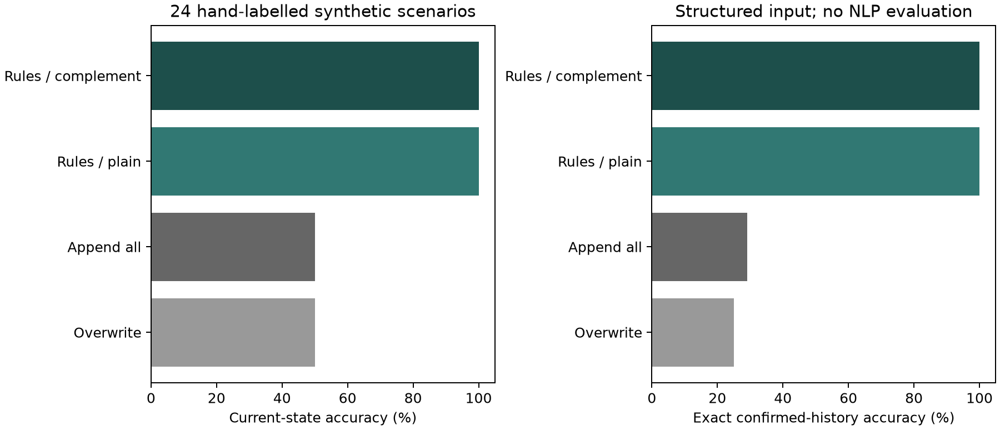
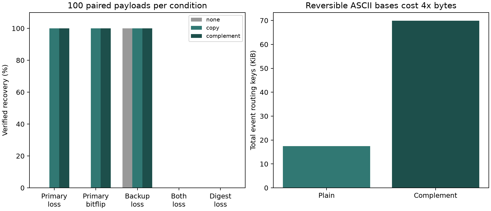

# 实验结果

版本：0.2.0.dev1；运行时间（UTC）：2026-10-24T07:48:39.281875+00:00；Python：3.11.7；固定种子：20261024。

这是带人工结构化标签的开发集验收；尚无独立留出集或统计显著性结论。自然语言原型评估见 [NL_RESULTS.md](NL_RESULTS.md)，真实 Harness 会话验收见 [evidence/01-e2e](../evidence/01-e2e/harness-results.json)。

## 记忆规则：24 组场景、47 次输入

| 方法 | 当前状态正确 | 确认历史序列正确 | 不应激活却激活 | 不确定输入误确认 |
| --- | --- | --- | --- | --- |
| 直接覆盖 | 12/24 (50.0%) | 6/24 (25.0%) | 20/47 | 7/7 |
| 全部追加并取最新 | 12/24 (50.0%) | 7/24 (29.2%) | 20/47 | 7/7 |
| 规则 + 普通索引 | 24/24 (100.0%) | 24/24 (100.0%) | 0/47 | 0/7 |
| 规则 + 互补索引 | 24/24 (100.0%) | 24/24 (100.0%) | 0/47 | 0/7 |

前两种基线没有确定性和重要性规则；差异主要说明规则的作用。普通/互补两种规则配置完全一致。7 条不确定输入覆盖 uncertain 与 inferred。

## 等预算恢复：每条件 100 份相同 payload

| 损坏方式 | 无冗余 | 普通副本 | 打包互补副本 |
| --- | --- | --- | --- |
| healthy | 100/100 | 100/100 | 100/100 |
| primary_loss | 0/100 | 100/100 | 100/100 |
| primary_bitflip | 0/100 | 100/100 | 100/100 |
| backup_loss | 100/100 | 100/100 | 100/100 |
| both_loss | 0/100 | 0/100 | 0/100 |
| checksum_loss | 0/100 | 0/100 | 0/100 |

普通与互补备份的冗余字节数完全一致，均为原 payload 总长度的一倍，且都使用每条 64 字节 ASCII SHA-256 摘要。恢复校验失败不猜测；主数据健康时“无备份”也能读取成功。该实验不覆盖文件级损坏。

## 索引：300 个主题，每配置查询 2100 次

| 配置 | 正确查询 | 每轮均值的中位数 | event 路由键字节 | 数据库文件字节 |
| --- | --- | --- | --- | --- |
| plain | 2100/2100 | 19.21 μs/次 | 17890 | 286720 |
| complement | 2100/2100 | 61.52 μs/次 | 71560 | 606208 |

互补 ASCII 键严格占 4 倍字节。本机此次端到端查询更慢；耗时包含键构造、查询、校验和 JSON 解析，固定执行次序会影响结果，不能外推成所有实现的性能比率。

## 复现与原始记录

运行 `PYTHONPATH=src python experiments/run.py`。两张图需要安装 matplotlib 后加 `--plots`（跑这次实验的环境没装 matplotlib，图中的历史数字来自基线运行，语义计数与本次一致）。完整结果见 [results.json](results/results.json)，逐输入状态见 [trace.json](results/trace.json)，所有人工预期见 [scenarios.json](scenarios.json)。重新运行会产生新的时间记录与本机性能数字；语义计数应保持一致。

后续独立评估见 [实验方案](../docs/EXPERIMENTS.md)。目前支持的结论是：本版规则实现通过已知开发场景；互补表示尚未显示独立优势。
